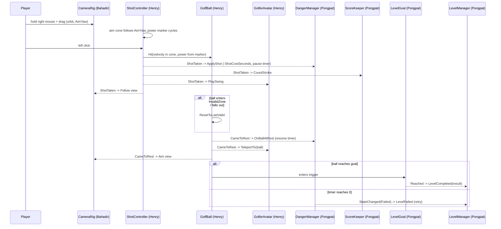

# Architecture and shared contracts (DRAFT, #6)

Status: **draft for review**. All three members must approve the PR (#6). After that, change a contract only through a PR reviewed by everyone it affects.

Sources: proposal §6 (gameplay, danger system, clubs) and §7 (level independence); PO decisions of 2026-10-26 (shot controls, clubs, timer, goal); ADR-0005, ADR-0010, ADR-0011.

## 1. Ownership
| Area | Owner | Components | Folder (`Assets/_Project/Scripts/Game/`) | Issues |
|---|---|---|---|---|
| Ball | Henry | `GolfBall`, `InvalidZone` | `Golf/` | #14 |
| Shot + clubs | Henry | `ShotController`, `AimCone`, `ClubProfile` | `Golf/` | #13, #15, #16, #70 |
| Golfer avatar | Henry | `GolferAvatar` (placeholder box for now) | `Player/` | #88, #36 |
| Cross-scene data | Henry | `GameSession` | `Session/` | #89 |
| Camera | Bahadir | `CameraRig` | `Camera/` | #19 |
| Danger (timer) | Pongpat | `DangerManager`, `DangerConfig` | `Danger/` | #7 |
| Goal + score | Pongpat | `LevelGoal`, `Cup`, `ScoreKeeper`, `LevelResult` | `Scoring/` | #18, #43 |
| Level flow | Pongpat | `LevelManager` | `Flow/` | #27 |
| HUD | Henry | `Hud` (reads the contracts, never writes) | `UI/` | #20, #78 |
| Level-specific | level owner | cat / wind + scarabs / ice + guardian | `Levels/Garden`, `Levels/Desert`, `Levels/Lake` | per level |

- Assembly: everything above is in `Project3DGP.Game` (namespace `Project3DGP.Game.<Folder>`). Generic, game-agnostic code (FSM base, timers, UI bars, ...) goes in `Project3DGP.Core` (ADR-0010).
- Scene files: `L1_Garden` = Henry, `L2_Desert` = Bahadir, `L3_Lake` = Pongpat, `MainMenu` = Henry (#30), `Ending` = Pongpat (#50). Only the owner edits a scene; shared objects are prefabs.
- **Each owner writes the code for their own contract** (LOC is counted per git author). Push a stub with the public API below early in Sprint 2 so the others can compile against it.

## 2. Rules
1. **Components talk through the public API below and C# events**, not by reaching into each other's fields.
2. **One `LevelManager` per level scene** holds serialized references to the shared components of that scene. Level-specific scripts get what they need from it. The only cross-scene object is `GameSession` (Henry).
3. **The shared components are prefabs** (`Prefabs/Shared/`). The level skeleton tool (#8, Magic > Level) drops them into a scene and wires them to the `LevelManager`.
4. **Level escalation listens to `DangerManager.StateChanged`**. Cat, sandstorm and ice cracks each live in their level folder, not in `DangerManager`.
5. **Tunable numbers live in ScriptableObjects** (`ClubProfile`, `DangerConfig`), so balancing (#46) doesn't need code changes. Each level has its own `DangerConfig`.
6. Input goes through the Input System actions (#13). Only `ShotController` (shoot, club switch) and `CameraRig` (orbit) read gameplay input.
7. **Keep it simple:** Unity physics simulates the ball; the GUI is plain uGUI (sprites later); the avatar is a box until the Blender model exists.

## 3. Gameplay loop (PO, 2026-10-26)
1. **Aiming.** The avatar stands at the ball. The player **holds the right mouse button and drags** to orbit the camera around the ball. An **aim cone** starts at the ball and points along the camera's horizontal forward; its width is the club's accuracy. A **vertical power meter on the left** of the screen has a marker that **keeps running up and down**. Number keys / mouse wheel switch clubs.
2. **Shot.** **Left click** shoots with the power under the marker (between the club's min and max). The real direction is random inside the cone. The timer loses the level's shot cost (e.g., 10 s).
3. **In flight.** The camera follows the ball. **The timer is paused.** Input is locked except god keys.
4. **Ball stops.** The timer resumes. The avatar **teleports** to the ball (next shooting position); back to step 1.
5. **Out of bounds / invalid area.** The ball goes back to the **nearest valid position** (its last position on valid ground) and play continues.
6. **Win:** the ball reaches the level goal (a cup for now; could be another target later). **Lose:** the timer reaches 0 while the player is aiming (it can't run out during flight, because it's paused).

## 4. Contracts
The signatures are the agreement. Names may still change in review; after approval they change only by PR.

### 4.1 Ball — Henry
```csharp
public class GolfBall : MonoBehaviour            // Rigidbody + SphereCollider
{
    public Vector3 Position { get; }
    public Vector3 Velocity { get; }
    public bool IsAtRest { get; }
    public Vector3 LastValidPosition { get; }   // last position on valid ground

    public void Hit(Vector3 velocity);                         // called by ShotController only
    public void AddExternalForce(Vector3 force, ForceMode mode); // wind (Desert), ice, traps
    public void ResetToLastValid();                            // out of bounds, invalid zone

    public event Action Launched;
    public event Action<Collision> Collided;    // sound, particles, noise gauge
    public event Action CameToRest;             // avatar teleports, next shot allowed
    public event Action WentOutOfBounds;        // raised before the reset
}

public class InvalidZone : MonoBehaviour { }   // trigger volume: water, outside the course, ...
```
Physics: a Rigidbody sphere with friction **rolls by itself** (PhysX spins it from contact friction; no fake animation). PhysX has no rolling resistance, so the ball uses linear/angular damping plus a rest threshold (speed below X for Y seconds → stop and raise `CameToRest`). Surfaces differ by `PhysicsMaterial` (#17). Falling below a kill height also counts as out of bounds.

### 4.2 Shot, aim cone and clubs — Henry
```csharp
public enum ShotPhase { Aiming, InFlight }

[CreateAssetMenu] public class ClubProfile : ScriptableObject
{
    public string DisplayName;
    public float MinSpeed, MaxSpeed;   // shooting range: power meter maps 0..1 to Min..Max
    public float AimConeDegrees;       // accuracy: full cone width; shot direction is random inside
    public float MarkerCycleSeconds;   // control: time for the marker to go up and down once
    public float LaunchPitch;          // fixed launch angle (no pitch control in MVP)
    public float Noise;                // Level 1 noise gauge (sledgehammer is loud)
    public GameObject ToolPrefab;      // what the avatar holds
}

public readonly struct ShotInfo
{
    public readonly ClubProfile Club;
    public readonly float AimYaw;        // camera yaw at the click, degrees
    public readonly float Power01;       // marker position at the click
    public readonly Vector3 Velocity;    // after cone randomization and LaunchPitch
}

public class ShotController : MonoBehaviour
{
    public ShotPhase Phase { get; }
    public ClubProfile CurrentClub { get; }
    public IReadOnlyList<ClubProfile> AvailableClubs { get; }   // from GameSession unlocks (#70)
    public float PowerMarker01 { get; }    // HUD power meter
    public bool InputEnabled { get; set; } // LevelManager turns it off on complete/fail/pause

    public void SelectClub(ClubProfile club);

    public event Action<ShotPhase> PhaseChanged;
    public event Action<ClubProfile> ClubChanged;
    public event Action<ShotInfo> ShotTaken;   // Danger deducts time, Score counts a stroke, cat hears noise
}
```
`AimCone` draws the cone at the ball (e.g., two lines or a flat mesh), pointing along `CameraRig.AimYaw`, width = `CurrentClub.AimConeDegrees`. Visible only while `Aiming`.

| Club | Range (Min..Max speed) | Accuracy (cone) | Notes |
|---|---|---|---|
| Standard golf club | mid | mid | the only club at the start (#70) |
| Sledgehammer | high | low (wide cone) | loud (Level 1 noise) |
| **Mysterious** (codename; real tool TBD) | low | high (narrow cone) | name and look to be decided |

### 4.3 Golfer avatar — Henry
```csharp
public class GolferAvatar : MonoBehaviour
{
    public void TeleportTo(Vector3 ballPosition, float aimYaw); // stands beside the ball, faces the aim
    public void FaceYaw(float aimYaw);                          // follows the camera while aiming
    public void SetTool(ClubProfile club);                      // swaps the held tool (ToolPrefab)
    public void PlaySwing(ClubProfile club);                    // triggered on ShotTaken
    public void PlayCelebrate(); public void PlayFail();
}
```
The avatar prefab keeps the visual in a child (`Visual/`): a **box for now**, later the Blender hamster with an Animator. Game code only calls the methods above, so replacing the model doesn't change any other script. Animation clips needed and the clip/timing handoff: see #36.

### 4.4 Camera — Bahadir
```csharp
public enum CameraView { Aim, Follow }

public class CameraRig : MonoBehaviour
{
    public CameraView View { get; }
    public float AimYaw { get; }                 // horizontal forward, degrees; the aim cone follows it
    public void SetView(CameraView view);        // smooth blend
    public void Shake(float strength, float duration);

    public event Action<CameraView> ViewChanged;
}
```
`Aim`: orbits around the ball while the right mouse button is held (yaw, plus a clamped pitch). `Follow`: after `ShotTaken`, follows the ball. Back to `Aim` on `GolfBall.CameToRest`, keeping the last yaw. The camera never moves the ball.

### 4.5 Danger (timer) — Pongpat
```csharp
public enum DangerState { Normal, Warning, Critical, Failed }

[CreateAssetMenu] public class DangerConfig : ScriptableObject   // one per level, set by hand
{
    public float StartSeconds;          // e.g., 180 for an easy level
    public float ShotCostSeconds;       // e.g., 10, deducted on every shot (like going over par)
    public float WarningBelowSeconds;   // remaining time thresholds
    public float CriticalBelowSeconds;
}

public class DangerManager : MonoBehaviour
{
    public DangerState State { get; }
    public float RemainingSeconds { get; }
    public float Progress01 { get; }     // 0 = full time left, 1 = time out (HUD bar)
    public bool IsRunning { get; }

    public void Begin();                  // LevelManager on level start
    public void Pause(); public void Resume(); // also used by the pause menu
    public void ApplyShot(ShotInfo shot); // wired to ShotController.ShotTaken: -ShotCostSeconds, then pauses
    public void OnBallAtRest();           // wired to GolfBall.CameToRest: resumes (or fails, see below)
    public void ResetDanger();            // retry

    public event Action<DangerState> StateChanged;   // level escalation + HUD icon
    public event Action<float> ProgressJumped;        // after a shot (HUD jump effect)
}
```
The timer **pauses while the ball is in flight** (from `ShotTaken` until `CameToRest`) and runs while the player aims. `Failed` is raised when `RemainingSeconds` reaches 0 while running.
If a shot's cost takes the timer to 0, that last shot still plays out: reaching the goal wins; otherwise `Failed` is raised when the ball comes to rest (draft, see open questions).

### 4.6 Goal and score — Pongpat
```csharp
public abstract class LevelGoal : MonoBehaviour   // what the ball must reach
{
    public event Action Reached;                  // fires once per attempt
}
public class Cup : LevelGoal { }                  // trigger at the hole; the only goal for now

public readonly struct LevelResult
{
    public readonly string LevelId;          // "L1_Garden"
    public readonly int Strokes;
    public readonly float RemainingSeconds;
    public readonly int Score;               // formula in #43
}

public class ScoreKeeper : MonoBehaviour
{
    public int Strokes { get; }
    public void CountStroke(ShotInfo shot);   // wired to ShotController.ShotTaken
    public LevelResult BuildResult(float remainingSeconds);
    public void ResetScore();

    public event Action<int> StrokesChanged;  // HUD stroke count
}
```

### 4.7 Level flow — Pongpat
```csharp
public enum LevelPhase { Intro, Playing, Completed, Failed }

public class LevelManager : MonoBehaviour
{
    [SerializeField] GolfBall ball;          [SerializeField] ShotController shot;
    [SerializeField] GolferAvatar avatar;    [SerializeField] CameraRig cameraRig;
    [SerializeField] DangerManager danger;   [SerializeField] ScoreKeeper score;
    [SerializeField] LevelGoal goal;

    public GolfBall Ball { get; }  /* ...read-only accessors for each reference... */
    public LevelPhase Phase { get; }

    public void StartLevel(); public void Retry(); public void LoadNext();

    public event Action LevelStarted;
    public event Action<LevelResult> LevelCompleted;
    public event Action LevelFailed;
}
```
`LevelManager` does the wiring: `ShotTaken` → `DangerManager.ApplyShot`, `ScoreKeeper.CountStroke`, `GolferAvatar.PlaySwing`; `GolfBall.CameToRest` → `DangerManager.OnBallAtRest`, `GolferAvatar.TeleportTo`; `LevelGoal.Reached` → completion; `DangerState.Failed` → failure. It reports results to `GameSession`. The proposal's generic "complete hole" fallback is a god key (#71) that calls the same completion path.

### 4.8 Game session — Henry
```csharp
public class GameSession : MonoBehaviour   // DontDestroyOnLoad, created by the first scene that needs it
{
    public static GameSession Instance { get; }
    public IReadOnlyList<ClubProfile> UnlockedClubs { get; }   // leveling (#70) unlocks more
    public int PlayerLevel { get; } public int Xp { get; }
    public void RecordResult(LevelResult result);
    public LevelResult? GetBestResult(string levelId);
    // Settings (volume, ...) for #77. Save/load (#44, Pongpat) serializes this data.
}
```

## 5. Event flow of one shot


## 6. Decided (PO, 2026-10-26)
- Shot cost is set **per level** (`DangerConfig.ShotCostSeconds`), not per club. The timer is in seconds; start time per level is set by hand by difficulty.
- The level fails only on timeout. Out of bounds / invalid area never fails; the ball returns to the nearest valid position.
- The timer pauses while the ball is in flight.
- Third tool codename: **Mysterious** (low range, high accuracy) until the real tool is decided.
- The game's hamster uses **Blender animation clips** driven by an Animator (#36). Mini-exercise 4.A.1 (#59) stays a standalone exercise and is not reused for the hamster.
- The goal is generic (`LevelGoal`); a cup for now.
- `GameSession` is owned by Henry.
- No "ideal one-shot range" mark on the power meter for now (maybe later).

## 7. Open questions
- Real name and look of the Mysterious tool.
- Last shot: if a shot's cost takes the timer to 0, does the shot still play out (draft: yes, win if it reaches the goal, fail when it stops), or does the level fail at once?
