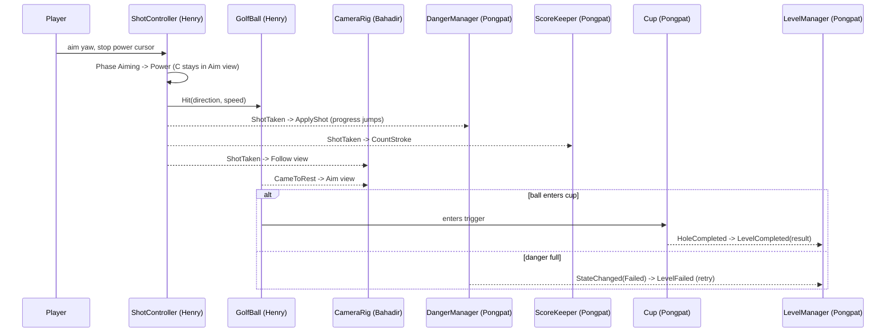

# Architecture and shared contracts (DRAFT, #6)

Status: **draft for review**. All three members must approve the PR (#6). After that, change a contract only through a PR reviewed by everyone it affects.

Sources: proposal §6 (gameplay, danger system, clubs) and §7 (level independence); ADR-0005, ADR-0010, ADR-0011.

## 1. Ownership
| Area | Owner | Components | Folder (`Assets/_Project/Scripts/Game/`) | Issues |
|---|---|---|---|---|
| Ball | Henry | `GolfBall` | `Golf/` | #14 |
| Shot + clubs | Henry | `ShotController`, `ClubProfile` | `Golf/` | #13, #15, #16, #70 |
| Camera | Bahadir | `CameraRig` | `Camera/` | #19 |
| Danger | Pongpat | `DangerManager`, `DangerConfig` | `Danger/` | #7 |
| Score + cup | Pongpat | `ScoreKeeper`, `Cup`, `LevelResult` | `Scoring/` | #18, #43 |
| Level flow | Pongpat | `LevelManager` | `Flow/` | #27 |
| HUD | Henry | `Hud` (reads the contracts, never writes) | `UI/` | #20, #78 |
| Level-specific | level owner | cat / wind + scarabs / ice + guardian | `Levels/Garden`, `Levels/Desert`, `Levels/Lake` | per level |

- Assembly: everything above is in `Project3DGP.Game` (namespace `Project3DGP.Game.<Folder>`). Generic, game-agnostic code (FSM base, timers, UI bars, ...) goes in `Project3DGP.Core` (ADR-0010).
- Scene files: `L1_Garden` = Henry, `L2_Desert` = Bahadir, `L3_Lake` = Pongpat, `MainMenu` = Henry (#30), `Ending` = Pongpat (#50). Only the owner edits a scene; shared objects are prefabs.
- **Each owner writes the code for their own contract** (LOC is counted per git author). Push a stub with the public API below early in Sprint 2 so the others can compile against it.

## 2. Rules
1. **Components talk through the public API below and C# events**, not by reaching into each other's fields.
2. **One `LevelManager` per level scene** holds serialized references to the shared components of that scene. Level-specific scripts get what they need from it. No cross-scene singletons, except an optional `GameSession` for data that survives scene loads (unlocked clubs, results, settings), added later by its owner.
3. **The shared components are prefabs** (`Prefabs/Shared/`). The level skeleton tool (#8, Magic > Level) drops them into a scene and wires them to the `LevelManager`.
4. **Level escalation listens to `DangerManager.StateChanged`**. Cat, sandstorm and ice cracks each live in their level folder, not in `DangerManager`.
5. **Tunable numbers live in ScriptableObjects** (`ClubProfile`, `DangerConfig`), so balancing (#46) doesn't need code changes.
6. Input goes through the Input System actions (#13). Only `ShotController` and `CameraRig` read gameplay input.

## 3. Contracts
The signatures are the agreement. Names may still change in review; after approval they change only by PR.

### 3.1 Ball — Henry
```csharp
public class GolfBall : MonoBehaviour            // Rigidbody ball
{
    public Vector3 Position { get; }
    public Vector3 Velocity { get; }
    public bool IsAtRest { get; }
    public Vector3 LastRestPosition { get; }

    public void Hit(Vector3 direction, float speed);           // called by ShotController only
    public void AddExternalForce(Vector3 force, ForceMode mode); // wind (Desert), ice, traps
    public void ResetToLastRest();                             // out of bounds, retry

    public event Action Launched;
    public event Action<Collision> Collided;    // sound, particles, noise gauge
    public event Action CameToRest;             // next shot allowed
    public event Action WentOutOfBounds;        // ball is then reset to LastRestPosition
}
```

### 3.2 Shot and clubs — Henry
```csharp
public enum ShotPhase { Idle, Aiming, Power, InFlight }

[CreateAssetMenu] public class ClubProfile : ScriptableObject
{
    public string DisplayName;
    public float MaxSpeed;          // Power
    public float CursorSpeed;       // Control: power cursor cycling speed
    public float AccuracyYawRange;  // Accuracy: +/- random yaw in degrees
    public float Noise;             // Level 1 noise gauge (sledgehammer is loud)
    public float DangerCost = 1f;   // multiplier on DangerConfig.ShotCost (open question Q1)
}

public readonly struct ShotInfo
{
    public readonly ClubProfile Club;
    public readonly float AimYaw;        // degrees, world space, before randomization
    public readonly float Power01;       // where the cursor stopped
    public readonly Vector3 Direction;   // after accuracy randomization
    public readonly float Speed;         // Power01 * Club.MaxSpeed
}

public class ShotController : MonoBehaviour
{
    public ShotPhase Phase { get; }
    public ClubProfile CurrentClub { get; }
    public IReadOnlyList<ClubProfile> AvailableClubs { get; }   // unlocks from leveling (#70)
    public float AimYaw { get; }          // camera follows this in Aim view
    public float PowerCursor01 { get; }   // HUD power bar
    public bool InputEnabled { get; set; } // LevelManager turns it off on complete/fail/pause

    public void SelectClub(ClubProfile club);

    public event Action<ShotPhase> PhaseChanged;
    public event Action<ClubProfile> ClubChanged;
    public event Action<ShotInfo> ShotTaken;   // Danger adds cost, Score counts a stroke, cat hears noise
}
```

### 3.3 Camera — Bahadir
```csharp
public enum CameraView { Aim, Follow, Overview }

public class CameraRig : MonoBehaviour
{
    public CameraView View { get; }
    public void SetView(CameraView view);          // smooth blend
    public void Shake(float strength, float duration);

    public event Action<CameraView> ViewChanged;
}
```
Default behaviour: `Aim` while `ShotController.Phase` is Aiming/Power (behind the ball, along `AimYaw`); `Follow` after `ShotTaken`; back to `Aim` on `GolfBall.CameToRest`. The player can toggle `Overview` (free look) while Idle/Aiming. The camera never moves the ball or changes the aim.

### 3.4 Danger — Pongpat
```csharp
public enum DangerState { Normal, Warning, Critical, Failed }

[CreateAssetMenu] public class DangerConfig : ScriptableObject
{
    public float TotalTimeUnits;
    public float UnitsPerSecond;    // continuous fill
    public float ShotCost;          // discrete jump per shot (x ClubProfile.DangerCost)
    [Range(0,1)] public float WarningAt;
    [Range(0,1)] public float CriticalAt;
}

public class DangerManager : MonoBehaviour
{
    public DangerState State { get; }
    public float Progress01 { get; }     // HUD time bar
    public bool IsRunning { get; }

    public void Begin();                 // LevelManager on level start
    public void Pause(); public void Resume();
    public void ApplyShot(ShotInfo shot); // wired to ShotController.ShotTaken
    public void ResetDanger();           // retry

    public event Action<DangerState> StateChanged;   // level escalation + HUD icon
    public event Action<float> ProgressJumped;        // after a shot (HUD jump effect)
}
```
"The last permitted shot stays achievable" (#7): when the bar fills while the ball is in flight, `Failed` is raised only after `GolfBall.CameToRest` without a hole completion (open question Q2).

### 3.5 Score and cup — Pongpat
```csharp
public class Cup : MonoBehaviour            // trigger at the hole
{
    public event Action HoleCompleted;      // fires once per attempt
}

public readonly struct LevelResult
{
    public readonly string LevelId;         // "L1_Garden"
    public readonly int Strokes;
    public readonly float DangerProgress01; // time used
    public readonly int Score;              // formula in #43
}

public class ScoreKeeper : MonoBehaviour
{
    public int Strokes { get; }
    public void CountStroke(ShotInfo shot);   // wired to ShotController.ShotTaken
    public LevelResult BuildResult(float dangerProgress01);
    public void ResetScore();

    public event Action<int> StrokesChanged;  // HUD stroke count
}
```

### 3.6 Level flow — Pongpat
```csharp
public enum LevelPhase { Intro, Playing, Completed, Failed }

public class LevelManager : MonoBehaviour
{
    [SerializeField] GolfBall ball;  [SerializeField] ShotController shot;
    [SerializeField] CameraRig cameraRig; [SerializeField] DangerManager danger;
    [SerializeField] ScoreKeeper score;   [SerializeField] Cup cup;

    public GolfBall Ball { get; }  /* ...read-only accessors for each reference... */
    public LevelPhase Phase { get; }

    public void StartLevel(); public void Retry(); public void LoadNext();

    public event Action LevelStarted;
    public event Action<LevelResult> LevelCompleted;
    public event Action LevelFailed;
}
```
`LevelManager` does the wiring (subscribes `DangerManager.ApplyShot` and `ScoreKeeper.CountStroke` to `ShotTaken`, `Cup.HoleCompleted` to completion, `DangerState.Failed` to failure). The proposal's generic "complete hole" fallback is a god key (#71) that calls the same completion path.

## 4. Event flow of one shot


## 5. Open questions (PO)
- **Q1** Does each club cost a different amount of danger time per shot (e.g., sledgehammer costs more)? Draft: `ClubProfile.DangerCost` multiplier, default 1. (Also in #7.)
- **Q2** If the bar fills while the ball is still rolling, do we wait for the ball to stop (or sink) before failing? Draft: yes.
- **Q3** Who owns `GameSession` (cross-scene data: unlocked clubs, results, settings)? Draft: Pongpat with save/load (#44); leveling (#70, Henry) reads/writes it.
