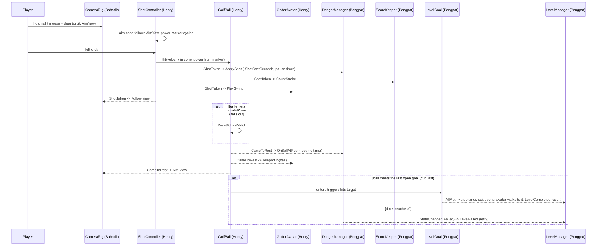

# Architecture and shared contracts (#6)

Status: **approved** by Henry, Bahadir and Pongpat (2026-10-26, #6). Change a contract only through a PR reviewed by everyone it affects.

Sources: proposal §6 (gameplay, danger system, clubs) and §7 (level independence); PO decisions of 2026-10-26 (shot controls, clubs, timer, goal); ADR-0005, ADR-0010, ADR-0011.

## 1. Ownership
| Area | Owner | Components | Folder (`Assets/_Project/Scripts/Game/`) | Issues |
|---|---|---|---|---|
| Ball | Henry | `GolfBall`, `InvalidZone`, `BallHitTarget` | `Golf/` | #14, #22 |
| Input | Henry | `GolfInput` (+ `GolfControls.inputactions` in `Settings/Input/`) | `Controls/` | #13 |
| Shot + clubs | Henry | `ShotController`, `AimCone`, `ClubProfile` | `Golf/` | #15, #16, #70 |
| Golfer avatar | Henry | `GolferAvatar` (placeholder box for now) | `Player/` | #88, #36 |
| Level exit | Henry | `LevelExit` (gate / portal) | `Flow/` | #38 |
| Cross-scene data | Henry | `GameSession` | `Session/` | #89 |
| Camera | Bahadir | `CameraRig` | `Camera/` | #19 |
| Danger (timer) | Pongpat | `DangerManager`, `DangerConfig` | `Danger/` | #7 |
| Goal + score | Pongpat | `LevelGoal`, `LevelGoals`, `Cup`, `ScoreKeeper`, `LevelResult` | `Scoring/` | #18, #43 |
| Level flow | Pongpat | `LevelManager` | `Flow/` | #27 |
| HUD | Henry | `Hud` (reads the contracts, never writes) | `UI/` | #20, #78 |
| Level-specific | level owner | cat / wind + scarabs / ice + guardian | `Levels/Garden`, `Levels/Desert`, `Levels/Lake` | per level |

- Assembly: everything above is in `Project3DGP.Game` (namespace `Project3DGP.Game.<Folder>`). Generic, game-agnostic code (FSM base, timers, UI bars, ...) goes in `Project3DGP.Core` (ADR-0010).
- Scene files: `L1_Garden` = Henry, `L2_Desert` = Bahadir, `L3_Lake` = Pongpat, `MainMenu` = Henry (#30), `Ending` = Pongpat (#50). Only the owner edits a scene; shared objects are prefabs.
- **Each owner writes the code for their own contract** (LOC is counted per git author). Push a stub with the public API below early in Sprint 2 so the others can compile against it.

## 2. Rules
1. **Components talk through the public API below and C# events**, not by reaching into each other's fields.
2. **One `LevelManager` per level scene** holds serialized references to the shared components of that scene. Level-specific scripts get what they need from it. The only cross-scene object is `GameSession` (Henry).
3. **The shared components are prefabs** (`Prefabs/Shared/`). The level skeleton tool (#8, Magic > Level, §4.10) gives every level the same slots; once the prefabs exist, it drops them in and wires them to the `LevelManager`.
4. **Level escalation listens to `DangerManager.StateChanged`**. Cat, sandstorm and ice cracks each live in their level folder, not in `DangerManager`.
5. **Tunable numbers live in ScriptableObjects** (`ClubProfile`, `DangerConfig`), so balancing (#46) doesn't need code changes. Each level has its own `DangerConfig`.
6. Input goes through the Input System actions via `GolfInput` (#13, §4.11). Only `ShotController` (shoot, club switch) and `CameraRig` (orbit, view) read gameplay input; `LevelManager` reads pause and retry.
7. **Keep it simple:** Unity physics simulates the ball; the GUI is plain uGUI (sprites later); the avatar is a box until the Blender model exists.

## 3. Gameplay loop (PO, 2026-10-26)
1. **Aiming.** The avatar stands at the ball. The player **holds the right mouse button and drags** to orbit the camera around the ball. An **aim cone** starts at the ball and points along the camera's horizontal forward; its width is the club's accuracy. A **vertical power meter on the left** of the screen has a marker that **keeps running up and down**. Number keys / mouse wheel switch clubs.
2. **Shot.** **Left click** shoots with the power under the marker (between the club's min and max). The real direction is random inside the cone. The timer loses the level's shot cost (e.g., 10 s).
3. **In flight.** The camera follows the ball. **The timer is paused.** Input is locked except god keys.
4. **Ball stops.** The timer resumes. The avatar **teleports** to the ball (next shooting position); back to step 1.
5. **Out of bounds / invalid area.** The ball goes back to the **nearest valid position** (its last position on valid ground) and play continues.
6. **Menu.** A **menu button at the upper right** opens the menu dialog; while it's open the **game is paused** (physics, timer, input). Menu items are undecided (#77).
7. **Win:** the ball meets **all of the level's goals** (PO, 2026-10-28). A goal is anything the ball must reach or hit: the cup, a target spot on a branch, a lever. Each level decides which goals it has and how many. They can be met in any order, **except the cup, which is always last**: until every other goal is met it ignores the ball, which rolls over it like normal ground. When all goals are met, **the timer stops** (the level can no longer fail), the **gate/portal opens**, and the hamster **walks to it by itself** (no new controls). Then the next level loads. **Lose:** the timer reaches 0 while the player is aiming (it can't run out during flight, because it's paused).

## 4. Contracts
The signatures are the agreement. Names may still change in review; after approval they change only by PR.

### 4.1 Ball — Henry
```csharp
public class GolfBall : MonoBehaviour            // Rigidbody + SphereCollider
{
    public Vector3 Position { get; }
    public Vector3 Velocity { get; }
    public bool IsAtRest { get; }
    public Vector3 LastValidPosition { get; }   // last position on valid ground

    public void Hit(Vector3 velocity);                         // called by ShotController only
    public void AddExternalForce(Vector3 force, ForceMode mode); // wind (Desert), ice, traps
    public void ResetToLastValid();                            // out of bounds, invalid zone

    public event Action Launched;
    public event Action<Collision> Collided;    // sound, particles
    public event Action CameToRest;             // avatar teleports, next shot allowed
    public event Action WentOutOfBounds;        // raised before the reset
}

public class InvalidZone : MonoBehaviour { }   // trigger volume: water, outside the course, ...
```
Physics: a Rigidbody sphere with friction **rolls by itself** (PhysX spins it from contact friction; no fake animation). PhysX has no rolling resistance, so the ball uses linear/angular damping plus a rest threshold (speed below X for Y seconds → stop and raise `CameToRest`). Surfaces differ by `PhysicsMaterial` (#17). Falling below a kill height also counts as out of bounds.
Implementation (#14, PO 2026-10-27): **at rest the ball is kinematic**, so `AddExternalForce` (wind, ice, traps) only acts while it moves. Stopped = speed < 0.15 m/s for 0.5 s, or a 20 s timeout (`Core/Motion/RestDetector`). `LastValidPosition` = the newest ground contact (sampled every 0.1 s, last second) that is clear of every `InvalidZone`, else where the ball last stopped. Out of bounds: `WentOutOfBounds` → reset → `CameToRest` (so the camera, timer and avatar treat it like a normal stop). Prefab: `Prefabs/Shared/GolfBall.prefab` (Magic > Game > Create Golf Ball Prefab).

### 4.2 Shot, aim cone and clubs — Henry
```csharp
public enum ShotPhase { Aiming, InFlight }

[CreateAssetMenu] public class ClubProfile : ScriptableObject
{
    public string DisplayName;
    public float MinSpeed, MaxSpeed;   // shooting range: power meter maps 0..1 to Min..Max
    public float AimConeDegrees;       // accuracy: full cone width; shot direction is random inside
    public float MarkerCycleSeconds;   // control: time for the marker to go up and down once
    public float LaunchPitch;          // fixed launch angle (no pitch control in MVP)
    public GameObject ToolPrefab;      // what the avatar holds
}

public readonly struct ShotInfo
{
    public readonly ClubProfile Club;
    public readonly float AimYaw;        // camera yaw at the click, degrees
    public readonly float Power01;       // marker position at the click
    public readonly Vector3 Velocity;    // after cone randomization and LaunchPitch
}

public class ShotController : MonoBehaviour
{
    public ShotPhase Phase { get; }
    public ClubProfile CurrentClub { get; }
    public IReadOnlyList<ClubProfile> AvailableClubs { get; }   // from GameSession unlocks (#70)
    public float PowerMarker01 { get; }    // HUD power meter
    public bool InputEnabled { get; set; } // LevelManager turns it off on complete/fail/pause

    public void SelectClub(ClubProfile club);

    public event Action<ShotPhase> PhaseChanged;
    public event Action<ClubProfile> ClubChanged;
    public event Action<ShotInfo> ShotTaken;   // Danger deducts time, Score counts a stroke, avatar swings
}
```
`AimCone` draws the cone at the ball (e.g., two lines or a flat mesh), pointing along `CameraRig.AimYaw`, width = `CurrentClub.AimConeDegrees`. Visible only while `Aiming`.
Implementation (#15): `ShotMath` holds the formula (speed = Lerp(Min, Max, power); yaw = aim + spread x cone/2; pitch = `LaunchPitch`). The marker is a Core `PingPongGauge` (one cycle = `MarkerCycleSeconds`). Club assets live in `Settings/Clubs/` (Magic > Game > Create Club Profiles). **TEMP(#19):** until `CameraRig` exists, the aim yaw comes from `Golf/TemporaryAimYaw.cs` (main camera's horizontal forward); delete that file and use `CameraRig.AimYaw` in `ShotController` and `AimCone` once #19 is merged (comment on #15 / #19).

| Club | Range (Min..Max speed) | Accuracy (cone) | Notes |
|---|---|---|---|
| Standard golf club | mid | mid | the only club at the start (#70) |
| Sledgehammer | high | low (wide cone) | fast marker (hard to time) |
| **Mysterious** (codename; real tool TBD) | low | high (narrow cone) | name and look to be decided |

Shipped defaults (#16, `Settings/Clubs/`, tune in the Inspector): Standard 4–16 m/s, cone 10°, marker 1.6 s, pitch 25° · Sledgehammer 8–26 m/s, cone 30°, marker 1.2 s, pitch 20° · Mysterious 2–10 m/s, cone 3°, marker 2 s, pitch 30°. Keys 1–3 pick the slot in `AvailableClubs` order, the wheel steps through it (wraps); only while `Aiming`.

### 4.3 Golfer avatar — Henry
```csharp
public class GolferAvatar : MonoBehaviour
{
    public void TeleportTo(Vector3 ballPosition, float aimYaw); // stands beside the ball, faces the aim
    public void FaceYaw(float aimYaw);                          // follows the camera while aiming
    public void SetTool(ClubProfile club);                      // swaps the held tool (ToolPrefab)
    public void PlaySwing(ClubProfile club);                    // triggered on ShotTaken
    public void PlayCelebrate(); public void PlayFail();
    public void WalkTo(Vector3 target, Action arrived);         // all goals met: walks to the open exit (#38)
}
```
The avatar prefab keeps the visual in a child (`Visual/`): a **box for now**, later the Blender hamster with an Animator. Game code only calls the methods above, so replacing the model doesn't change any other script. Animation clips needed and the clip/timing handoff: see #36.
Implementation (#88): `Prefabs/Shared/GolferAvatar.prefab` is a **variant of `Prefabs/Characters/Hamster`** (Magic > Game > Create Golfer Avatar Prefab), so the Blender model replaces the Hamster's `Visual` once and the avatar follows. The tool goes to the child named `ToolSocket` (right hand). `TeleportTo` stands at `standOffset` (left of and behind the ball, in the aim's frame) snapped to the ground; `FaceYaw` circles the ball keeping that stance. `PlaySwing`/`PlayCelebrate`/`PlayFail` set Animator triggers `Swing`/`Celebrate`/`Fail` when the model has an Animator (#36), else a small code fallback (shoulder swing, hop, lean back). The avatar has no collider (the ball passes through).

### 4.4 Camera — Bahadir
```csharp
public enum CameraView { Aim, Follow }

public class CameraRig : MonoBehaviour
{
    public CameraView View { get; }
    public float AimYaw { get; }                 // horizontal forward, degrees; the aim cone follows it
    public void SetView(CameraView view);        // smooth blend
    public void Shake(float strength, float duration);

    public event Action<CameraView> ViewChanged;
}
```
`Aim`: orbits around the ball while the right mouse button is held (yaw, plus a clamped pitch). `Follow`: after `ShotTaken`, follows the ball. Back to `Aim` on `GolfBall.CameToRest`, keeping the last yaw. The camera never moves the ball.

### 4.5 Danger (timer) — Pongpat
```csharp
public enum DangerState { Normal, Warning, Critical, Failed }

[CreateAssetMenu] public class DangerConfig : ScriptableObject   // one per level, set by hand
{
    public float StartSeconds;          // e.g., 180 for an easy level
    public float ShotCostSeconds;       // e.g., 10, deducted on every shot (like going over par)
    public float WarningBelowSeconds;   // remaining time thresholds
    public float CriticalBelowSeconds;
}

public class DangerManager : MonoBehaviour
{
    public DangerState State { get; }
    public float RemainingSeconds { get; }
    public float Progress01 { get; }     // 0 = full time left, 1 = time out (HUD bar)
    public bool IsRunning { get; }

    public void Begin();                  // LevelManager on level start
    public void Pause(); public void Resume(); // also used by the pause menu
    public void ApplyShot(ShotInfo shot); // wired to ShotController.ShotTaken: -ShotCostSeconds, then pauses
    public void OnBallAtRest();           // wired to GolfBall.CameToRest: resumes (or fails, see below)
    public void ResetDanger();            // retry

    public event Action<DangerState> StateChanged;   // level escalation + HUD icon
    public event Action<float> ProgressJumped;        // after a shot (HUD jump effect)
}
```
The timer **pauses while the ball is in flight** (from `ShotTaken` until `CameToRest`) and runs while the player aims. `Failed` is raised when `RemainingSeconds` reaches 0 while running.
If a shot's cost takes the timer to 0, that last shot still plays out: **if it goes in, the player wins**; otherwise `Failed` is raised when the ball comes to rest.

### 4.6 Goal and score — Pongpat
```csharp
public abstract class LevelGoal : MonoBehaviour   // something the ball must reach or hit
{
    public bool IsMet { get; }
    public bool Accepting { get; set; }           // false = ignores the ball (the cup until the others are met)
    public void ResetGoal();                      // retry: not met again
    public event Action<LevelGoal> Reached;       // fires once per attempt
}
public class Cup : LevelGoal { }                  // trigger at the hole; always the LAST goal
public class BallHitTarget : LevelGoal { }        // Henry (#22): met when the ball touches it (branch target spot, lever);
                                                  // reusable for other levels' targets (e.g. #24)

public class LevelGoals : MonoBehaviour           // all goals of the level (the children of Gameplay/Goal)
{
    public int MetCount { get; } public int Total { get; }
    public void ResetGoals();                     // retry
    public event Action<int, int> ProgressChanged;  // (met, total): HUD "goals 1/3"
    public event Action AllMet;                   // LevelManager: win
}

public readonly struct LevelResult
{
    public readonly string LevelId;          // "L1_Garden"
    public readonly int Strokes;
    public readonly float RemainingSeconds;
    public readonly int Score;               // formula in #43
}

public class ScoreKeeper : MonoBehaviour
{
    public int Strokes { get; }
    public void CountStroke(ShotInfo shot);   // wired to ShotController.ShotTaken
    public LevelResult BuildResult(float remainingSeconds);
    public void ResetScore();

    public event Action<int> StrokesChanged;  // HUD stroke count
}
```

### 4.7 Level flow — Pongpat
```csharp
public enum LevelPhase { Intro, Playing, Completed, Failed }

public class LevelManager : MonoBehaviour
{
    [SerializeField] GolfBall ball;          [SerializeField] ShotController shot;
    [SerializeField] GolferAvatar avatar;    [SerializeField] CameraRig cameraRig;
    [SerializeField] DangerManager danger;   [SerializeField] ScoreKeeper score;
    [SerializeField] LevelGoals goals;       [SerializeField] LevelExit exit;

    public GolfBall Ball { get; }  /* ...read-only accessors for each reference... */
    public LevelPhase Phase { get; }

    public void StartLevel(); public void Retry(); public void LoadNext();
    public bool IsPaused { get; }
    public void SetPaused(bool paused);   // menu dialog: Time.timeScale = 0, DangerManager.Pause, shot input off

    public event Action LevelStarted;
    public event Action<LevelResult> LevelCompleted;
    public event Action LevelFailed;
    public event Action<bool> PausedChanged;
}
```
`LevelManager` does the wiring: `ShotTaken` → `DangerManager.ApplyShot`, `ScoreKeeper.CountStroke`, `GolferAvatar.PlaySwing`; `GolfBall.CameToRest` → `DangerManager.OnBallAtRest`, `GolferAvatar.TeleportTo`; `LevelGoals.AllMet` → completion (stop the timer, `LevelExit.Open`, `GolferAvatar.WalkTo(exit.WalkTarget)`, then `LoadNext`); `DangerState.Failed` → failure. It reports results to `GameSession`. The proposal's generic "complete hole" fallback is a god key (#71) that calls the same completion path.

### 4.7b Level exit — Henry (#38)
```csharp
public class LevelExit : MonoBehaviour   // the gate (L1) / portal: closed until all goals are met
{
    public bool IsOpen { get; }
    public Transform WalkTarget { get; } // where the hamster walks to; arriving there loads the next level
    public void Open();                  // LevelManager on LevelGoals.AllMet
    public event Action Opened;          // FX, sound
}
```

### 4.8 HUD layout — Henry (menu dialog: Pongpat)
| Screen position | Element | Source |
|---|---|---|
| Upper left | **Time bar** (visible) + Warning/Critical icon | `DangerManager.Progress01`, `StateChanged` |
| Upper right | **Menu button** → menu dialog; opening it pauses the game | `LevelManager.SetPaused` |
| Left side, vertical | Power meter with the running marker | `ShotController.PowerMarker01` |
| Bottom | **Dialog bar** (tutorial prompts in L1, story lines); non-blocking, skippable | `GardenTutorial` (#28), generic dialog box in `Core/UI` |
| Elsewhere (TBD) | Club name, stroke count, later XP bar and minimap (#78) | `ShotController`, `ScoreKeeper`, `GameSession` |

Plain uGUI for now (sprites later). The menu dialog and its items are #77 (items undecided).

### 4.9 Game session — Henry
```csharp
public class GameSession : MonoBehaviour   // DontDestroyOnLoad, created by the first scene that needs it
{
    public static GameSession Instance { get; }
    public IReadOnlyList<ClubProfile> UnlockedClubs { get; }   // leveling (#70) unlocks more
    public int PlayerLevel { get; } public int Xp { get; }
    public void RecordResult(LevelResult result);
    public LevelResult? GetBestResult(string levelId);
    // Settings (volume, ...) for #77. Save/load (#44, Pongpat) serializes this data.
}
```

### 4.10 Level scene hierarchy (#8)
Every level scene has the same root objects. **Magic > Level > Create Level Scene Skeleton** adds any that are missing, and **Magic > Level > Validate Level Scene** lists what's missing. The list itself is in `Editor/Magic/LevelSkeleton.cs`.

```
Systems                 LevelManager, DangerManager, ScoreKeeper, ShotController (owners' prefabs, Sprint 3)
Cameras                 Main Camera, CameraRig (Bahadir)
Environment             static only
├── Lighting            Directional Light, Global Volume, sky
├── Course              playable greybox; Ground (50 x 50 m plane)
├── Boundary            walls or edges that keep the ball in
└── Props               decoration (counts toward the >= 100 objects, #74)
Gameplay                what the ball and player interact with
├── BallSpawn           the tee
├── Player              GolfBall + GolferAvatar (Henry)
├── Goal                LevelGoals; children = the goals: Cup (always last), BallHitTargets (branch, lever, ...)
├── Exit                LevelExit: the gate / portal to the next level (#38)
├── Hazards             cat / wind / ice (level-specific scripts)
└── InvalidZones        InvalidZone triggers: water, out of bounds
UI                      HUD canvas, menu dialog
```

The tool moves only the default `Main Camera`, `Directional Light` and `Global Volume` from the scene root into their group, keeping their world position; it never changes anything else. Until the prefabs exist, the slots are empty placeholders. Later the tool will add each owner's prefab into its slot (#95).

**Filling the slots (#95).** *Magic > Level > Add Ball, Shot and Avatar* fills Henry's slots in the open level scene: the `ShotController` on `Systems/ShotController`; the `GolfBall` on the tee, the `GolferAvatar` and the `AimCone` under `Gameplay/Player`; and `UI/HUD` with the power meter. Until the owners' code is in, it also adds two stand-ins, which should be deleted later. `TEMP(#19)` is an `OrbitFollowCamera` on `Cameras/Main Camera`, replaced by the CameraRig. `TEMP(#27)` is `Systems/AvatarWiring_TEMP`, replaced by the LevelManager. The tool also adds `InvalidZone` to the Pond prefab, with the trigger raised to 0.5 m above the water. The second half of #95 (CameraRig, LevelManager, DangerManager, ScoreKeeper, Cup) follows when #19, #27, #7 and #18 are merged.

**Placeholder prefabs** (*Magic > Prefabs > Create Placeholder Prefabs*, `Prefabs/Course|Nature|Characters/`): each prefab has a root that holds the colliders (and later the scripts), plus a `Visual` child that holds the meshes. To use a real model, open the prefab and replace `Visual`; every placed copy updates. **Terrain** (*Magic > Level > Create Level Terrain*): 50 × 50 m with its surface at y = 0 and 2 m of depth below for ponds. Layers are Grass, Fairway, Sand and Snow; the data is in `Art/Terrain/<Scene>_TerrainData.asset`.

### 4.11 Input — Henry (#13)
```csharp
[CreateAssetMenu] public class GolfInput : ScriptableObject   // one shared asset: Settings/Input/GolfInput.asset
{
    public void Acquire();                 // in OnEnable; the first user turns the actions on
    public void Release();                 // in OnDisable; the last user turns them off
    public bool GameplayEnabled { get; set; }   // off during flight and pause; pause/retry stay on

    public bool IsOrbiting { get; }        // right mouse held (CameraRig)
    public Vector2 OrbitDelta { get; }     // mouse delta this frame while orbiting, else zero (CameraRig)

    public event Action Shoot;             // left click (ShotController)
    public event Action<int> ClubSlotSelected; // keys 1-3 -> 0..2 (ShotController)
    public event Action<int> ClubCycled;   // wheel: -1 previous, +1 next (ShotController)
    public event Action ToggleView;        // V (CameraRig, optional overview)
    public event Action Pause;             // Esc (LevelManager)
    public event Action Retry;             // R (LevelManager)
}
```
Keyboard + mouse only (PO, 2026-10-27; no gamepad). Action maps: `Gameplay` (Orbit, Look, Shoot, Club1-3, ClubScroll, ToggleView) and `System` (Pause, Retry). Prefabs reference the same `GolfInput.asset` (Magic > Game > Create Golf Input Asset). Default keys are listed in the README.

## 5. Event flow of one shot


## 6. Decided (PO, 2026-10-26)
- Shot cost is set **per level** (`DangerConfig.ShotCostSeconds`), not per club. The timer is in seconds; start time per level is set by hand by difficulty.
- The level fails only on timeout. Out of bounds / invalid area never fails; the ball returns to the nearest valid position.
- The timer pauses while the ball is in flight.
- Last shot: if a shot's cost takes the timer to 0, the shot still plays out; if it goes in, the player wins.
- Third tool codename: **Mysterious** (low range, high accuracy) until the real tool is decided.
- The game's hamster uses **Blender animation clips** driven by an Animator (#36). Mini-exercise 4.A.1 (#59) stays a standalone exercise and is not reused for the hamster.
- The goal is generic (`LevelGoal`). **2026-10-28:** a level can have several goals (cup, branch target spot, lever). All must be met, and the cup is always last. Then the timer stops, the gate/portal opens, and the hamster walks there by itself to load the next level. The water-splash trap and the Level 1 noise gauge are dropped.
- `GameSession` is owned by Henry.
- No "ideal one-shot range" mark on the power meter for now (maybe later).
- HUD: time bar visible at the upper left; menu button at the upper right; opening the menu pauses the game. Menu items undecided.
- **Level 1 has no noise mechanism** (2026-10-28): clubs have no noise value, and the cat follows only the danger timer: Normal = asleep, Warning = twitching, then suspicious (eyes half open), Critical = searching (sits up, watches the ball), Failed = **awake = game over**. Code: `Levels/Garden/CatAlertMachine` (FSM, #79) and `GardenCat` (#21); the cat listens to `DangerManager.StateChanged` (rule 4).

## 7. Open questions
- Real name and look of the Mysterious tool.
- Menu dialog items (#77).
